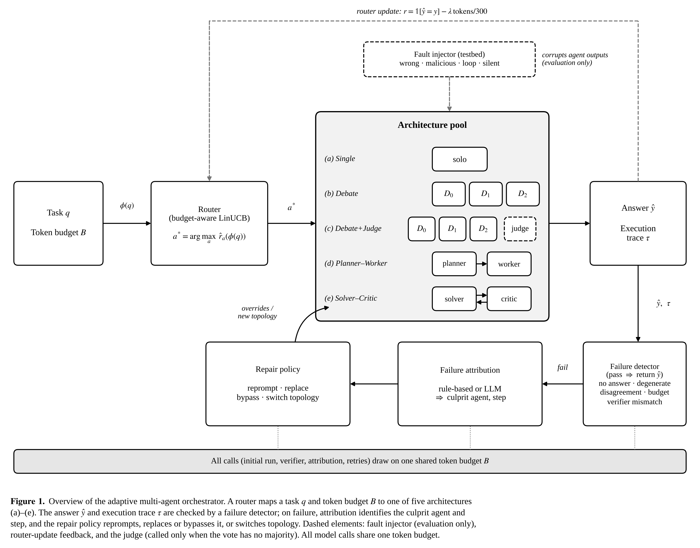

# Adaptive Multi-Agent Orchestrator with Failure Attribution

## Problem statement
Can a system decide, per task and within a token budget, whether to use a
**single agent**, **debate**, or **planner-worker** — and, when it fails,
identify the responsible agent/step and repair its own topology?

## Architecture
<p align="center"></p>

**Fig. 1.** System architecture. A task $q$ with token budget $B$ is routed by a budget-aware LinUCB policy to one of three
architectures (single, debate, planner-worker). The answer $\hat y$ and execution trace $\tau$ pass through a failure detector;
on failure, attribution identifies the culprit agent and step, and the repair policy reprompts, replaces, bypasses the agent or
switches topology. Dashed elements: the fault injector (evaluation only) and the router-update feedback. All calls share one
token budget. Vector version: `docs/fig_architecture.pdf`; regenerate with `python docs/make_figure.py`.

## Components
1. **Learned router** (contextual bandit) - picks the cheapest architecture likely to succeed.
2. **Failure attribution agent** - reads a trace, blames an agent/step, triggers a repair.
3. **Fault-injection testbed** - deliberately breaks agents to measure recovery.

## Status
- [x] Project skeleton
- [x] LLM layer with token/cost accounting (`mas/llm.py`: `TokenMeter`, hard budget, Mock + Anthropic backends)
- [x] Benchmarks (`mas/benchmarks/tasks.py`: synthetic difficulty-graded arithmetic, GSM8K jsonl loader, train/test split)
- [x] Architectures (`mas/core.py` runtime with trace + repair hooks; `mas/architectures/impl.py`: single, debate, planner-worker)
- [x] Router (`mas/router/`: observable task features, budget-aware LinUCB, full-info + bandit training, counterfactual replay evaluation, oracle)
- [x] Fault injection (`mas/faults.py`: wrong, malicious, loop, silent; `mas/testbed.py`: fault sweeps)
- [x] Failure attribution (`mas/attribution.py`: zero-token `RuleAttributor`, `LLMAttributor`, agent/step-level scoring against injected-fault ground truth)
- [x] Repair policy + self-healing orchestrator (`mas/repair.py`, `mas/orchestrator.py`: route -> run -> detect -> attribute -> reprompt/replace/bypass/switch topology, shared token budget)
- [x] FastAPI service (`api/main.py`: `/solve`, `/router/train`, `/faults/sweep`, `/architectures`, `/health`)
- [x] Statistics (`mas/stats.py`: bootstrap CIs, paired differences) and main comparison (`experiments/main_results.py`)
- [x] Ablations (`experiments/ablation.py` -> `results/ablation.md`: never / blind retry / attribution / attribution+switch / oracle trigger)
- [x] Technical report draft (`docs/report.md`)

## Early observations (mock backend, 100 tasks, rule attributor)
| Architecture | Fault | Agent-level attribution |
|---|---|---|
| single | any | 1.00 (trivial: one agent) |
| planner_worker | any | 1.00 (trivial: fault sits on last answerer) |
| debate | loop / silent | 1.00 |
| debate | wrong / malicious | 0.68 (n=200; was 0.54 using final-round only, 0.41 using round-1 only) |

Debate is the informative case: in round 2 the healthy debaters read the faulty
peer's answer and often converge to it, so the *outlier signal disappears*.
Scoring disagreement across *all* rounds beat both final-round-only and round-1-only voting; the remaining gap motivates the LLM attributor.
Numbers come from the offline mock solver; re-run with `LLM_BACKEND=anthropic` for real results.

## Design assumptions (read before interpreting results)
- **Shared budget:** all attempts (initial run + repairs + LLM attribution) draw from one token budget per task.
- **Failure trigger:** `detector` uses only inference-time signals (no answer, degenerate output, debate disagreement, budget overrun). `oracle` uses ground truth and is reported only as an upper bound. A single agent that is *confidently wrong* is undetectable by the detector - a known limitation.
- **Topology switch = fresh agents:** faults are bound to agent names, so switching architecture escapes a broken agent. The `allow_switch=False` ablation isolates this effect.

## Quick start
```bash
pip install -r requirements.txt
cp .env.example .env            # LLM_BACKEND=mock (offline) or anthropic
python -m pytest -q
uvicorn api.main:app --reload   # docs at http://127.0.0.1:8000/docs
```
Example: a single agent whose output collapses into a loop is detected, blamed, replaced:
```bash
curl -X POST localhost:8000/solve -H 'content-type: application/json' -d '{
  "question": "(3 + 4) * 5", "answer": "35", "architecture": "single", "use_router": false,
  "faults": [{"agent": "solo", "kind": "loop"}]}'
```

## Main results (SIMULATED mock solver - not evidence about real LLMs)
Full tables with 95% bootstrap CIs: `results/main_results_homogeneous.md`, `results/main_results_heterogeneous.md`
(3 seeds x 200 test tasks; reward = correct - 0.3 * tokens/300).

| Environment | Setting | Router (full-info) vs best fixed, reward | Router (bandit) vs best fixed |
|---|---|---|---|
| homogeneous (gains equal across difficulty) | unconstrained | -0.002 [-0.003, -0.001] (tiny, but significant *loss*) | -0.021 [-0.064, 0.021] n.s. |
| heterogeneous (debate helps mainly on hard tasks) | unconstrained | **+0.040 [0.018, 0.062]** significant | 0.000 n.s. (collapses to debate) |
| heterogeneous | budget = 150 tokens | 0.000 n.s. | -0.032 [-0.083, 0.017] n.s. |

What this says, honestly:
1. **A router can only win if architectures are heterogeneous.** With uniform gains it correctly degrades to the best fixed choice.
2. **When heterogeneity exists, a learned router wins** (+0.04 reward, cheaper than always-debate: 187 vs 255 tokens at similar accuracy).
3. **Partial-feedback learning (bandit) did not recover this** in 3 epochs over 200 tasks: it needs more data/exploration. Open problem, reported as-is.
4. **Under a tight budget the router gives no gain here**: debate gets truncated by the budget, so the feasible set collapses.
5. The oracle (0.86) is *not* a realistic ceiling: it picks per-sample on realised noise.

**Limitation:** all numbers come from a simulated solver whose structure was chosen by me (hence two environments). Real conclusions require `LLM_BACKEND=anthropic` on GSM8K/HumanEval/HotpotQA.

## Ablation findings (SIMULATED mock solver; 3 seeds x 100 tasks; full table in `results/ablation.md`)
| Finding | Evidence (accuracy) |
|---|---|
| **Attribution + replace recovers detectable faults** (loop/silent) | single: 0.00 -> 0.57; planner_worker: 0.00 -> 0.67; debate: 0.70 -> 0.85 |
| **Blind retry is useless against persistent faults and wastes 3x tokens** | single loop@1.0: 0.00 at 108 tokens vs 0.57 at 72 with attribution |
| **Attribution beats blind retry on intermittent faults, and is cheaper** | single loop@0.5: 0.51 / 63 tok (blind) vs 0.57 / 54 tok; planner_worker: 0.53 vs 0.65 |
| **Confidently-wrong faults are invisible to the detector** | single/planner_worker wrong & malicious: no method but the oracle trigger moves accuracy off ~0 |
| **Negative result: repairing debate on disagreement hurts** | debate wrong@1.0: 0.59 (never) -> 0.54 (attr), tokens 255 -> 740 |
| **Topology switch added nothing here** | `attr (no switch)` == `attr + switch` in every scenario: replace/reprompt fixed things before escalation was needed |

Caveats: `oracle trigger` knows ground-truth correctness, so it is best-of-n with a perfect verifier - an upper bound, not a deployable method.
An intermittent-fault RNG bug (all-or-nothing per seed) was found and fixed during this study; a regression test covers it.

### Follow-up: verifier signal + topology switch (addresses gaps 1 and 3 below)
`verify=True` adds one independent re-solve; a mismatch with the topology's answer counts as a failure.
| Scenario | attr (no switch) | + verifier, **no switch** | + verifier, **+ switch** |
|---|---|---|---|
| single, wrong@1.0 | 0.02 / 36 tok | 0.04 / 143 | **0.79** / 397 |
| planner_worker, wrong@1.0 | 0.01 / 80 | 0.01 / 230 | **0.83** / 494 |
| single, clean | 0.57 / 36 | 0.68 / 115 | 0.85 / 227 |

- The verifier makes confident-wrong faults *visible*, but **only the topology switch repairs them** (the faulty agent persists; fresh agents in a new topology escape it). This is the first scenario where switching is demonstrably necessary.
- **Caution on the clean row:** the 0.85 is mostly extra test-time compute (verified retries escalating to debate), not fault repair. Budget-matched comparison: plain debate = 0.82 @ 255 tokens vs 0.85 @ 227 here - roughly parity, *not* a win.
- Debate under wrong/malicious faults is still not rescued by the verifier (0.55): unsolved.

### What the findings imply for next steps
1. ~~Add a verifier signal~~ done (see above); next: replace the same-model verifier with a cheaper/different one and measure false-alarm cost.
2. Make the debate trigger **consensus-margin aware** instead of "any disagreement".
3. ~~Scenario where the switch is necessary~~ done (persistent wrong-answer fault); next: shared-role failures that follow the agent across topologies.

## Running with a real LLM
```bash
export LLM_BACKEND=anthropic ANTHROPIC_API_KEY=...   # or: LLM_BACKEND=openai OPENAI_API_KEY=... MODEL_NAME=gpt-4o-mini
# keys go in environment variables only - never commit them
python experiments/main_results.py --n-train 100 --n-test 100   # costs real API tokens; start small
```
The synthetic arithmetic generator is the only built-in benchmark; use `mas.benchmarks.tasks.load_gsm8k_jsonl` for GSM8K-format files.
