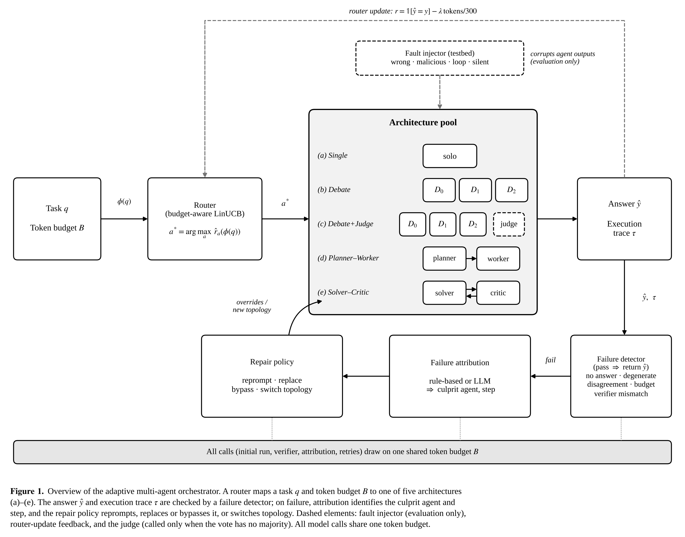
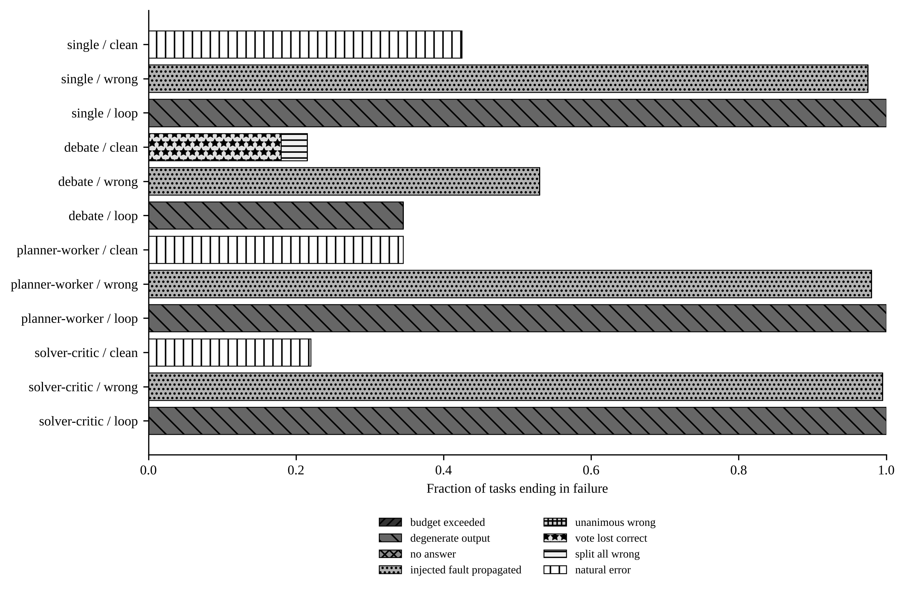

# Adaptive Multi-Agent Orchestrator: Documentation

This document describes what the project contains, how each part works, how to run it, and what the current results do and do not show.

> **Important:** every quantitative result in this document was produced with an **offline simulated solver** (the "mock" backend), not a real language model. The simulator's structure was chosen by the author, so the results validate the *machinery* (routing, attribution, repair, evaluation) and generate hypotheses. They are not evidence about real LLM behaviour. See [Limitations](#9-limitations-and-threats-to-validity).

## Contents
1. [Overview](#1-overview)
2. [System architecture](#2-system-architecture)
3. [How a request is processed](#3-how-a-request-is-processed)
4. [Components](#4-components)
5. [REST API](#5-rest-api)
6. [Configuration](#6-configuration)
7. [Experiments and how to reproduce them](#7-experiments-and-how-to-reproduce-them)
8. [Results](#8-results)
9. [Limitations and threats to validity](#9-limitations-and-threats-to-validity)
10. [Project structure](#10-project-structure)
11. [Testing](#11-testing)
12. [Roadmap](#12-roadmap)

---

## 1. Overview

**Question studied.** Can a multi-agent system decide, per task and within a token budget, which agent architecture to use, and when a run fails, can it identify the responsible agent and repair its own topology?

**What is implemented.**

| Capability | Summary |
|---|---|
| Five architectures | single, debate, debate+judge, planner-worker, solver-critic |
| Learned router | Budget-aware LinUCB contextual bandit that picks an architecture from observable task features |
| Fault injection | Four fault kinds (wrong, malicious, loop, silent), persistent or intermittent |
| Failure detection | Inference-time signals: missing answer, degenerate output, low debate agreement, budget overrun, optional verifier |
| Failure attribution | Zero-token rule-based attributor and an LLM attributor, scored against injected-fault ground truth |
| Repair | Reprompt, replace, bypass an agent, or switch the whole topology |
| Shared budget | One token budget covers the initial run, verification, attribution and every retry |
| Failure taxonomy | Every wrong answer is classified into one of eight causes |
| Statistics | Bootstrap confidence intervals and paired bootstrap differences |
| Service | FastAPI app with router training, solving, fault sweeps and run logs |
| Backends | Mock (offline, default), Anthropic, OpenAI |

---

## 2. System architecture



*Vector version: `docs/fig_architecture.pdf`. Regenerate with `python docs/make_figure.py`.*

The pipeline has three layers:

1. **Selection layer:** the router chooses an architecture for each task.
2. **Execution layer:** the chosen architecture runs its agents. All model calls go through one wrapper that records a trace, applies injected faults and counts tokens.
3. **Self-healing layer:** a detector checks the result; on failure an attributor names the culprit and a repair policy changes the agent or topology before retrying.

---

## 3. How a request is processed

1. **Input.** A task `q` and an optional token budget `B`.
2. **Routing.** The router converts `q` into a feature vector and selects the architecture with the best predicted reward among those whose average cost fits within `B`. If no router is trained, a default architecture is used.
3. **Execution.** The architecture's agents run. Every call is added to a trace and charged to a single token meter. If the budget is exhausted mid-run, the run stops and returns the best answer so far, flagged `budget_exceeded`.
4. **Detection.** The detector flags the result if any of these hold: no answer was parsed; an agent produced empty or heavily repetitive output; in debate, the agreement share is below the configured threshold; the budget was exceeded; or (optionally) an independent verifier solved the task and disagreed.
5. **Accept or repair.** If nothing is flagged, the answer is returned. Otherwise:
   1. The **attributor** reads the trace and names a culprit agent and step.
   2. The **repair policy** picks an action (see 4.8).
   3. The architecture is re-run with that change, until the repair limit or budget is reached.
6. **Output.** Final answer, full trace, repair history, token total and attempt count.

---

## 4. Components

### 4.1 LLM layer (`mas/llm.py`)
- `BaseLLM.call(meter, system, prompt)` wraps every model call and charges a `TokenMeter`.
- `TokenMeter(budget)` accumulates input and output tokens and raises `BudgetExceeded` when the budget is passed.
- Backends:
  - `MockLLM`: deterministic, offline. It simulates a noisy solver whose accuracy falls with task difficulty and rises when the prompt carries extra signal (peer answers, a plan, a critique). Setting the environment variable `MOCK_HETERO=1` switches to a scenario where debate helps mainly on hard tasks.
  - `AnthropicLLM` and `OpenAILLM`: real API calls. Keys are read from environment variables only.
- Token counts for the mock are a word-based estimate; real backends report actual usage.

### 4.2 Benchmarks (`mas/benchmarks/tasks.py`)
- `Task(id, question, answer, difficulty, domain)` and a numeric `check` function.
- `generate_synthetic(n, seed)`: arithmetic expressions in four difficulty levels (difficulty `d` uses `d+1` operations).
- `load_gsm8k_jsonl(path)`: loader for GSM8K-format files (`answer` containing `#### <number>`).
- `split(tasks, train_frac)`: disjoint train/test split.

### 4.3 Architectures (`mas/architectures/impl.py`)

| Name | Agents | Flow | Typical calls |
|---|---|---|---|
| `single` | `solo` | One agent answers | 1 |
| `debate` | `debater_0..2` | Round 1: independent answers. Round 2: each sees the others' answers and revises. Majority vote | 6 |
| `debate_judge` | `debater_0..2`, `judge` | Same debate, but when the vote has no majority the judge solves independently and breaks the tie; the judge is called only on splits | 6 to 7 |
| `planner_worker` | `planner`, `worker` | Planner writes a plan; worker solves using it | 2 |
| `solver_critic` | `solver`, `critic` | Solver answers; critic re-solves independently; on mismatch the solver revises with the critique | 2 to 3 |

That is nine solving roles in total. Two further roles exist outside the architectures: the optional **verifier** (an independent re-solve used by the detector) and the **LLM attributor**.

All architectures share one runtime (`mas/core.py`): the `Context` object records each step, applies per-agent faults and honours repair overrides (`reprompt`, `replace`, `bypass`).

### 4.4 Router (`mas/router/`)
- **Features** (`features.py`): seven observable features such as number of digits, operator and keyword counts, length, presence of parentheses. The ground-truth difficulty label is never used.
- **Policy** (`bandit.py`): LinUCB with one ridge model per architecture. Reward is `correct − λ · tokens / 300`. Architectures whose average observed cost exceeds the remaining budget are excluded.
- **Training** (`train.py`): two modes. *Full-information* trains on a log where every architecture was run on every task. *Bandit* simulates partial feedback (only the chosen architecture's outcome is seen).
- **Evaluation:** counterfactual replay on a held-out full-information log, with an oracle policy as an upper bound.
- **Persistence:** `LinUCBRouter.save()` and `.load()` use JSON.

### 4.5 Fault injection (`mas/faults.py`, `mas/testbed.py`)

| Kind | Effect on the targeted agent's output |
|---|---|
| `wrong` | Plausible but incorrect numeric answer |
| `malicious` | Confident, persuasive text carrying a wrong answer |
| `loop` | Degenerate repetition with no answer |
| `silent` | Empty output |

Each fault has a trigger probability (`1.0` is persistent; `0.5` is intermittent). The random stream is salted by the run seed so intermittent faults vary across runs (an early bug where it did not was found and fixed, with a regression test). The testbed runs sweeps across architectures and fault scenarios.

### 4.6 Failure detection (`mas/repair.py::detect_failure`)
Uses only signals available at inference time. For debate, `min_agreement` sets the required share of agreeing agents: `1.0` flags any disagreement; `0.66` accepts a 2-of-3 majority and flags only genuine splits. An optional verifier adds an independent re-solve whose mismatch counts as failure.

A single agent that is *confidently wrong* is undetectable without a verifier.

### 4.7 Failure attribution (`mas/attribution.py`)
- **`RuleAttributor`** (zero tokens): blames an agent with degenerate or missing output; otherwise, for three or more answering agents, blames the agent that disagrees with the per-round majority most often; otherwise the final answerer.
- **`LLMAttributor`**: sends the formatted trace to a model and parses `BLAME:` and `REASON:`; its token cost is charged to the total.
- **Scoring:** `score_attribution` reports agent-level and step-level accuracy against the faults the testbed injected.

### 4.8 Repair policy (`mas/repair.py::RepairPolicy`)

| Situation | Action |
|---|---|
| First offence, degenerate output | `replace`: use a fresh, fault-free agent |
| First offence, otherwise | `reprompt`: add a correction note |
| Repeat offender and the agent is bypassable | `bypass`: drop it from the topology |
| Otherwise | `switch`: change architecture (fresh agents) |

Escalation map: single → debate; planner_worker → debate; debate → planner_worker; solver_critic → debate; debate_judge → planner_worker. Switching can be disabled (`allow_switch=False`) for ablations.

### 4.9 Orchestrator (`mas/orchestrator.py`)
Ties the pieces together. Options: `router`, `default_arch`, `attributor` (or `None` for a blind-retry ablation), `policy`, `max_repairs`, `trigger` (`detector`, `oracle` or `never`), `min_agreement`, `verify`. The `oracle` trigger uses ground truth and is reported only as an upper bound. The returned result includes the total token count, attempts, and a history of what was blamed and repaired.

### 4.10 Failure taxonomy (`mas/taxonomy.py`)
Classifies each wrong answer: `budget_exceeded`, `degenerate_output`, `no_answer`, `injected_fault_propagated`, `unanimous_wrong`, `vote_lost_correct`, `split_all_wrong`, `natural_error`. Needs ground truth, so it is an analysis tool and not part of the runtime loop.

### 4.11 Run log (`mas/runlog.py`)
Append-only JSONL of every `/solve` call with answer, tokens, attempts, full trace and repair history.

### 4.12 Statistics (`mas/stats.py`)
`bootstrap_ci` and `paired_diff_ci` (2000 resamples, 95% by default). Passing `clusters=` (for example task ids) resamples whole clusters, which is required because several seeds and methods run the same task and are therefore not independent. A difference is called significant only if its interval excludes zero.

---

## 5. REST API

Start the service: `uvicorn api.main:app --reload`. Interactive docs are at `/docs`.

| Method and path | Purpose |
|---|---|
| `GET /health` | Status and whether a router is trained |
| `GET /architectures` | Available architectures and fault kinds |
| `POST /solve` | Run the orchestrator on one question |
| `POST /router/train` | Train a router on synthetic tasks (`n_tasks`, `lam`, `seed`) |
| `POST /router/save` | Save the trained router to `results/router.json` (fixed path) |
| `GET /router/status` | Training info |
| `POST /faults/sweep` | Accuracy and tokens per architecture and fault scenario |
| `GET /runs?limit=N` | Recent logged runs |

**`POST /solve` fields:** `question`, `answer` (optional, enables a correctness flag), `difficulty`, `budget`, `architecture` (force one), `use_router`, `trigger`, `attributor` (`rule` or `llm`), `allow_switch`, `verify`, `min_agreement`, `max_repairs`, `faults` (list of `{agent, kind, prob}`), `seed`.

Example: a single agent whose output collapses into a loop is detected, blamed and replaced.

```bash
curl -X POST localhost:8000/solve -H 'content-type: application/json' -d '{
  "question": "(3 + 4) * 5", "answer": "35", "architecture": "single", "use_router": false,
  "faults": [{"agent": "solo", "kind": "loop"}]}'
```

Note: with the mock backend, `question` must be an arithmetic expression. With a real backend any text question works.

---

## 6. Configuration

| Variable | Meaning |
|---|---|
| `LLM_BACKEND` | `mock` (default), `anthropic` or `openai` |
| `ANTHROPIC_API_KEY` / `OPENAI_API_KEY` | Provider keys, environment only |
| `MODEL_NAME` | Model for the real backends (check current model names) |
| `MOCK_HETERO` | `1` selects the heterogeneous mock scenario |
| `RUN_LOG`, `RUN_LOG_ENABLED` | Run-log path and on/off switch |

Never commit keys. `.env` is git-ignored; `.env.example` shows the format.

---

## 7. Experiments and how to reproduce them

| Script | Output | Purpose |
|---|---|---|
| `experiments/main_results.py` | `results/main_results_<tag>.md` | Fixed architectures vs router vs oracle, unconstrained and with a hard budget |
| `experiments/ablation.py` | `results/ablation.md` | Repair-loop ablation under injected faults |
| `experiments/taxonomy.py` | `results/taxonomy.md`, `docs/fig_taxonomy.*` | Failure causes by architecture and fault |
| `docs/make_figure.py` | `docs/fig_architecture.*` | Regenerates Figure 1 |

```bash
pip install -r requirements.txt
python -m pytest -q
python experiments/main_results.py --tag homogeneous
MOCK_HETERO=1 python experiments/main_results.py --tag heterogeneous
python experiments/ablation.py
python experiments/taxonomy.py
```

All runs use fixed seeds. To use a real model, set `LLM_BACKEND` and the key, **start with a small run** (for example `--n-train 30 --n-test 30`), and set a spending limit with your provider; debate makes many calls per task.

---

## 8. Results

Protocol: three seeds, 100 to 200 tasks per cell, 95% cluster-bootstrap confidence intervals (cluster = task), paired cluster bootstrap for differences, router trained on disjoint tasks. Full tables are in `results/`.

### 8.1 Routing (3 seeds × 200 test tasks, reward = correct − 0.3 · tokens/300)

| Environment | Setting | Full-information router vs best fixed | Bandit router vs best fixed |
|---|---|---|---|
| Homogeneous (equal gains at all difficulties) | unconstrained | −0.002 [−0.004, 0.000], n.s. | −0.021 [−0.065, 0.021], n.s. |
| Heterogeneous (debate helps on hard tasks) | unconstrained | **+0.040 [0.015, 0.065]** | 0.000, n.s. |
| Heterogeneous | 150-token hard budget | 0.000, n.s. | −0.032 [−0.081, 0.021], n.s. |

All intervals are **cluster bootstrap over tasks** (see 4.12). An earlier version used an iid bootstrap that treated repeated runs of the same task as independent; correcting this widened intervals by roughly 15% and turned the homogeneous-environment result from a tiny "significant loss" into "not significant".

Reading: a router can only win when architectures differ in where they help. When they do, the full-information router wins at lower cost than always-debate (187 vs 255 tokens). Learning from partial feedback did not recover this with the data used. Under a tight budget the feasible set collapses. The oracle is not a realistic ceiling because it picks using realised noise.

### 8.2 Attribution

| Architecture | Fault | Agent-level accuracy |
|---|---|---|
| single, planner_worker | any | 1.00 (trivial: one candidate or fault on final answerer) |
| debate | loop, silent | 1.00 |
| debate | wrong, malicious | 0.68 (n = 200) |

For debate, three voting rules were compared: final round only (0.54), round 1 only (0.41), disagreement across all rounds (0.68). Healthy debaters tend to converge on a faulty peer, which erases the outlier signal.

### 8.3 Self-repair (ablation)

| Finding | Evidence (accuracy) |
|---|---|
| Attribution plus replace recovers detectable faults | single 0.00 → 0.57; planner_worker 0.00 → 0.67; debate (loop) 0.70 → 0.85 |
| Blind retry is useless against persistent faults and costs about 3× tokens | single, loop persistent: 0.00 at about 108 tokens vs 0.57 at about 72 |
| Attribution beats blind retry on intermittent faults and is cheaper | single loop@0.5: 0.51 (63 tokens) vs 0.57 (54 tokens) |
| Confidently wrong faults are invisible to the heuristic detector | no non-oracle method moves accuracy off about 0 for single and planner_worker |
| Verifier plus topology switch repairs them | single wrong: 0.04 without switch vs 0.79 with; planner_worker: 0.01 vs 0.83 |
| Consensus-margin detector fixes the debate over-repair problem | debate wrong: 0.56 / 744 tokens (strict) → 0.79 / 411 (margin 2/3) |

Caveats: the `oracle` trigger is best-of-n with a perfect verifier (an upper bound, not deployable). Verifier-based gains on clean tasks are largely extra test-time compute: verifier plus switch reaches 0.85 at 227 tokens, roughly parity with plain debate (0.82 at 255).

### 8.4 New architectures (simulated; hypotheses only)

| Architecture | Accuracy | Tokens/task |
|---|---|---|
| single | 0.67 | 36 |
| planner_worker | 0.68 | 80 |
| solver_critic | 0.82 | 107 |
| debate | 0.78 | 255 |

`debate_judge` vs `debate` (400 tasks): 0.853 [0.817, 0.887] vs 0.795 [0.755, 0.833], paired difference +0.058 [0.035, 0.083], for about 9 extra tokens (judge called on 23% of tasks). These gains depend on simulator parameters the author chose, and on independent errors. Real models make correlated errors, so the effects may shrink.

### 8.5 Failure taxonomy



In clean debate, 18 of the 21 failure points are `vote_lost_correct`: a correct answer existed among the debaters and the majority vote discarded it. This motivated `debate_judge`. `unanimous_wrong` is zero only because the mock draws errors independently.

---

## 9. Limitations and threats to validity

1. **Simulated solver.** All numbers come from a mock whose accuracy structure the author designed (two environments are reported for this reason). Conclusions about real models require runs with a real backend on GSM8K, HumanEval or HotpotQA. Only numeric-answer tasks are implemented.
2. **Independent errors.** The mock draws errors independently. Real models have correlated errors, which weakens voting, verification and judging.
3. **Fault binding.** Faults are tied to agent names, so a topology switch gives fresh agents by construction. Shared-role failures that follow the agent across topologies are not tested.
4. **Same-model verifier and judge.** They share the solver's blind spots.
5. **Token counts** for the mock are estimates.
6. **Oracle numbers** are upper bounds only.
7. **Small scale.** Three seeds and 100 to 200 tasks per cell; a bug in the intermittent-fault generator was found and fixed during the study, which is a reminder that the testbed itself needs scrutiny.
8. The citations in `docs/report.md` were written from memory and must be verified before any submission.

---

## 10. Project structure

```
api/main.py                 FastAPI service
mas/
  llm.py                    LLM backends, TokenMeter, budget
  core.py                   Context, trace, runtime
  architectures/impl.py     five architectures and registry
  router/                   features, LinUCB, training/evaluation
  faults.py, testbed.py     fault injection and sweeps
  attribution.py            rule and LLM attributors, scoring
  repair.py                 detector and repair policy
  orchestrator.py           self-healing loop
  taxonomy.py               failure classification
  runlog.py, stats.py       run log, bootstrap statistics
  benchmarks/tasks.py       tasks, generator, GSM8K loader
experiments/                main results, ablation, taxonomy
docs/                       this file, report draft, figures
results/                    generated result tables
tests/                      45 tests
```

---

## 11. Testing

`python -m pytest -q` runs 45 tests covering the LLM and budget layer, tasks, architectures, faults (including a regression test for intermittent faults), attribution, router training and persistence, orchestration, taxonomy, statistics and the API. The tests use the mock backend, so they are free and offline. The real-backend code paths (Anthropic, OpenAI) are exercised only through a fake client and have not been run against live APIs.

---

## 12. Roadmap

1. Run the main experiments with a real model on GSM8K, HumanEval and HotpotQA, and update Section 8 with real data.
2. Replace the same-model verifier with a different or cheaper one and measure false-alarm cost.
3. Test shared-role failures that follow an agent across topologies.
4. Improve partial-feedback router training (more exploration, more data).
5. Add an accuracy-versus-cost frontier figure.
