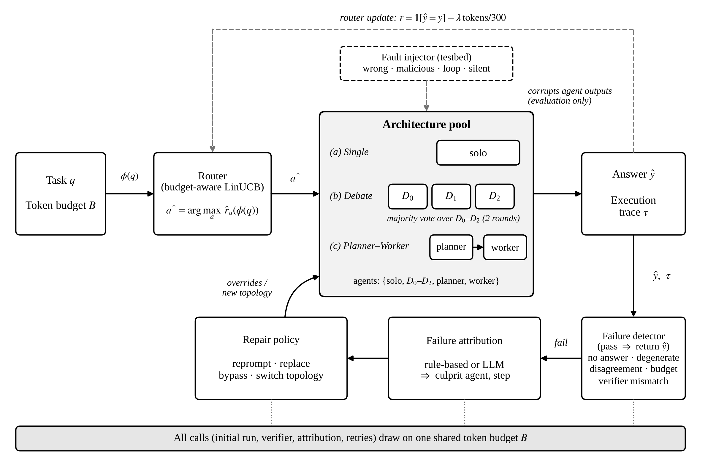

# Adaptive Multi-Agent Orchestration with Failure Attribution and Self-Repair
*Draft technical report (workshop format). All quantitative results below come from a **simulated solver**; real-LLM replication is pending (see Limitations).*

## 1. Introduction
Multi-agent LLM systems are usually fixed pipelines. Prior work reports that their gains often vanish under equal compute budgets and that failures are hard to localise. We ask: *can a system choose its topology per task within a token budget, and when it fails, identify the responsible agent and repair itself?*

## 2. System

*Fig. 1. System architecture (see `docs/make_figure.py`).*

- **Architectures:** single agent, 3-agent two-round debate with majority vote, planner-worker.
- **Router:** budget-aware LinUCB over observable task features, reward = correct - lambda * tokens / 300.
- **Fault injection:** wrong, malicious (confident-wrong), loop, silent; persistent or intermittent.
- **Attribution:** zero-token rule attributor (degenerate output; per-round disagreement) and an LLM attributor.
- **Repair:** reprompt, replace, bypass, or switch topology (fresh agents). All attempts share one token budget.
- **Failure signals:** degenerate output, missing answer, debate disagreement, budget overrun, optional independent verifier.

## 3. Experimental protocol
3 seeds x 100-200 tasks per cell; 95% bootstrap CIs over (task, seed); paired bootstrap for differences. Router trained on disjoint tasks. Oracle policies are reported only as upper bounds. Code: `experiments/main_results.py`, `experiments/ablation.py`.

## 4. Results
**4.1 Routing.** With homogeneous architecture gains, the learned router reduces to the best fixed policy (reward -0.002 [-0.003,-0.001]). With heterogeneous gains (debate helps mainly on hard tasks) the full-information router beats the best fixed policy by +0.040 [0.018, 0.062] reward at 187 vs 255 tokens. A bandit trained from partial feedback (3 epochs, 200 tasks) did not (0.000), and under a 150-token hard budget no router gain appeared because the feasible set collapses.

**4.2 Attribution.** Zero-token attribution is perfect on loop/silent faults. For debate with wrong/malicious faults, agent-level accuracy is 0.54 (final round), 0.41 (round 1), 0.68 (disagreement across all rounds): healthy debaters converge to a faulty peer in later rounds, erasing the outlier signal.

**4.3 Self-repair.** Detectable faults: attribution + replace raises accuracy 0.00 -> 0.57 (single), 0.00 -> 0.67 (planner-worker), 0.70 -> 0.85 (debate); blind retry gives 0.00 on persistent faults at 3x tokens and is dominated by attribution on intermittent faults (0.51 vs 0.57 single, 0.53 vs 0.65 planner-worker, with fewer tokens). Confident-wrong faults are invisible to heuristics; adding an independent verifier makes them visible, but only the topology switch repairs them (0.04 without switch vs 0.79 with, single; 0.01 vs 0.83, planner-worker).

**4.4 Negative results.** (i) Repairing debate on mere disagreement lowers accuracy (0.59 -> 0.54) and triples tokens. (ii) Verifier+switch on clean tasks reaches 0.85 @ 227 tokens, roughly parity with plain debate (0.82 @ 255): its gain is test-time compute, not repair. (iii) The bandit router underperforms full-information training.

## 5. Limitations
1. The solver is simulated; architecture-benefit structure was chosen by us (hence two environments). Conclusions about real LLMs require `LLM_BACKEND=anthropic` runs on GSM8K / HumanEval / HotpotQA.
2. Fault-to-agent binding means a topology switch gives fresh agents by construction; shared-role failures are untested.
3. The verifier shares the solver's model; correlated errors are not modelled.
4. Only numeric-answer tasks are implemented; token counts for the mock are word-based estimates.

## 6. Related work to position against
Debate (Du et al., 2023); equal-budget critiques of multi-agent gains; Who&When failure attribution; "Why do multi-agent LLM systems fail?"; automated workflow design (AFlow, MaAS, GPTSwarm). *Verify exact citations before submission.*
